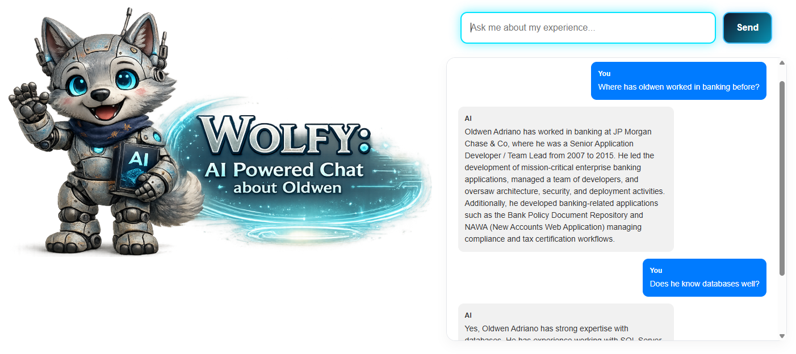
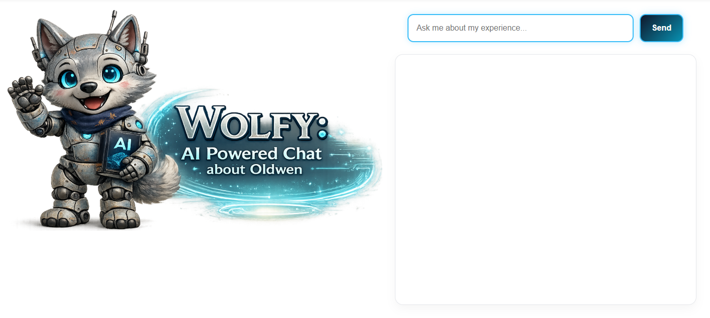

# Wolf's Azure AI Tools API

An ASP.NET Core Web API that powers an AI portfolio chatbot using Azure OpenAI and a markdown-based knowledge retrieval system.

## Overview

This project demonstrates a production-style AI application architecture built with .NET and Azure OpenAI.

The API receives chat requests from a Blazor frontend, retrieves relevant knowledge from structured markdown files, builds a context-aware prompt, and returns an AI-generated response.

## Screenshots

### AI Chat Interface



### Chat Entry Experience



## Technologies Used

### Backend
- ASP.NET Core Web API
- C#
- REST APIs

### AI Integration
- Azure OpenAI
- Prompt Engineering
- Context Injection
- Retrieval-Augmented Generation (RAG)

### Retrieval System
- Markdown Knowledge Base
- Section-Based Retrieval
- Keyword Matching

### Frontend
- Blazor

### Tooling
- Git
- Visual Studio

## Local Development Setup

### Requirements

- .NET 8 SDK
- Azure OpenAI Resource
- Visual Studio 2022

### Configuration

This project uses ASP.NET Core User Secrets for local development.

Example:

```json
{
  "AzureOpenAI": {
    "Endpoint": "YOUR_ENDPOINT",
    "ApiKey": "YOUR_API_KEY",
    "DeploymentName": "YOUR_DEPLOYMENT_NAME"
  }
}

### Run the API

dotnet run
The API will be available at https://localhost:7240/api/Chat

### Future Improvements

Planned future enhancements include:

- Semantic vector search using Azure OpenAI embeddings
- Cosine similarity retrieval
- Persistent conversation memory
- Conversation/session storage
- Advanced ranking and retrieval scoring
- Streaming AI responses
- Authentication and authorization
- Conversation analytics and telemetry
- Docker containerization
- Azure deployment pipeline
- Automated testing

## Example Questions

Example prompts the chatbot can answer:

- "What AI technologies has Allen worked with?"
- "What CRM experience does Allen have?"
- "Tell me about the AI chatbot project."
- "What enterprise systems has Allen built?"
- "What blockchain experience does Allen have?"
- "What backend technologies does Allen specialize in?"


## Key Features

- ASP.NET Core Web API backend
- Azure OpenAI integration
- Markdown-based knowledge base
- Keyword-based retrieval
- Context-aware AI responses
- Server-side conversation orchestration
- GitHub-safe configuration using User Secrets

## Architecture

```text
Blazor Frontend
    ↓
ASP.NET Core Web API
    ↓
KnowledgeContextService
    ↓
Markdown Knowledge Base
    ↓
Azure OpenAI